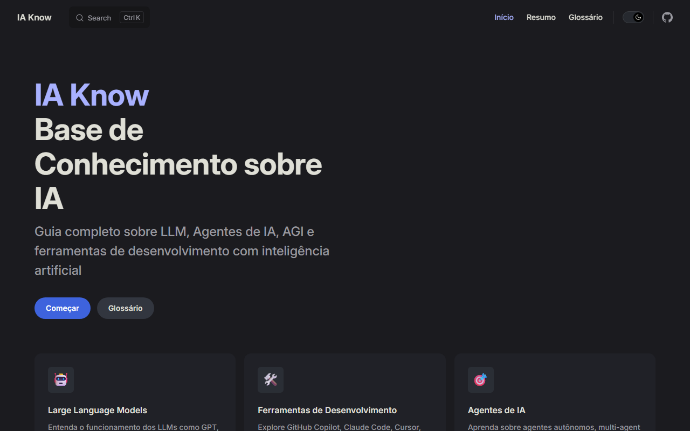
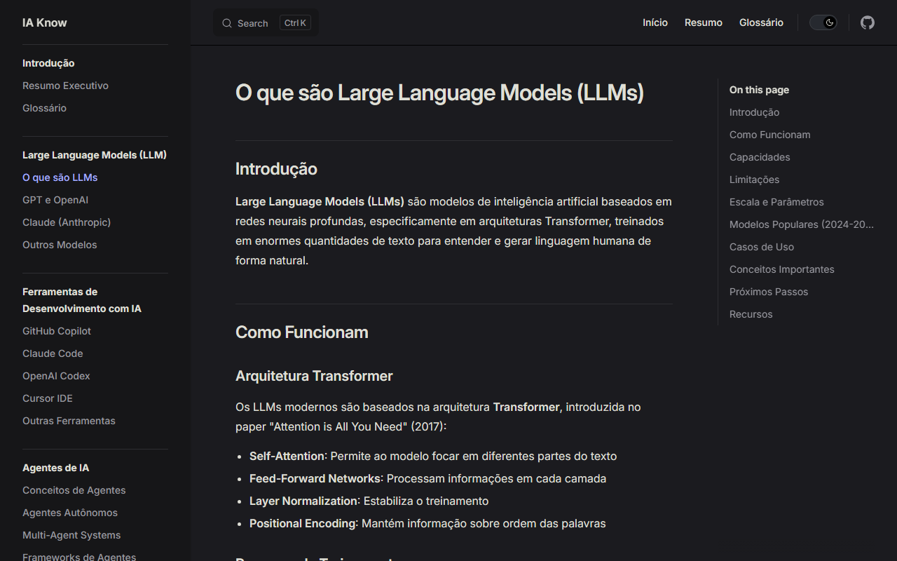
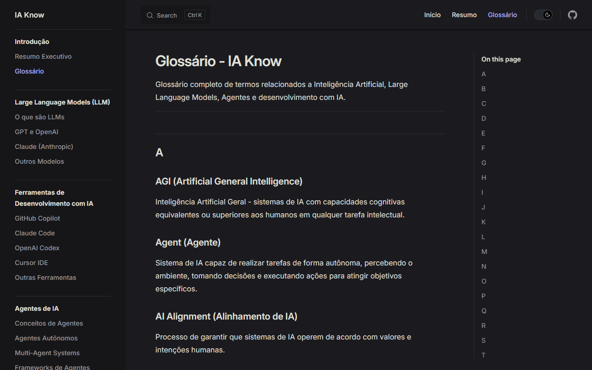
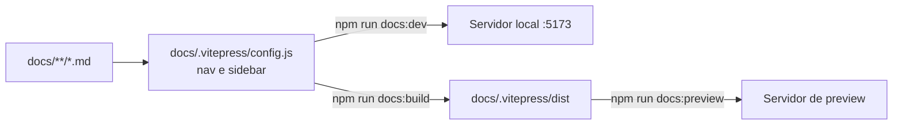

<div align="center">


# IA Know 🤖

**Base de conhecimento completa sobre IA, LLM, Agentes e ferramentas de desenvolvimento com Inteligência Artificial.**<br/>
Site estático em VitePress, em português, com glossário e 5 seções de conteúdo.

[](https://opensource.org/licenses/MIT)
[](https://vitepress.dev/)

<br/>



</div>

> Clone, instale e rode `npm install && npm run docs:dev`, depois abra http://localhost:5173.

## 📚 Sobre

**IA Know** é uma base de conhecimento centralizada e em constante evolução para desenvolvedores que desejam entender e utilizar:

- **🧠 Large Language Models (LLMs)**: GPT, Claude, Gemini, LLaMA, Mistral
- **🤖 Agentes de IA**: Sistemas autônomos, multi-agent systems, frameworks
- **🛠️ Ferramentas de Desenvolvimento**: GitHub Copilot, Claude Code, Cursor, Codex
- **🎯 AGI**: Conceitos de Inteligência Artificial Geral
- **✨ Boas Práticas**: Prompt engineering, segurança, ética

## 🖼️ Tour

<table>
<tr>
<td width="50%"><br/><b>Páginas de conteúdo</b> com barra lateral por tema.</td>
<td width="50%"><br/><b>Glossário</b> de termos técnicos de A a Z.</td>
</tr>
</table>

<sub>Capturas do site local (`npm run docs:preview`), tema escuro padrão, sem dados pessoais.</sub>

## 🚀 Acesso Rápido

### Documentação Online
A documentação completa está disponível em formato VitePress:

```bash
# Instalar dependências
npm install

# Rodar localmente
npm run docs:dev

# Build para produção
npm run docs:build
```

Acesse: `http://localhost:5173`

### Documentação

| Documento | O que tem |
|---|---|
| 📝 [Resumo Executivo](docs/resumo.md) | visão geral de todos os tópicos |
| 📚 [Glossário Completo](docs/glossario.md) | dicionário de termos técnicos de A-Z |
| 🧠 [Large Language Models](docs/llm/introducao.md) | GPT, Claude, Gemini e outros |
| 🛠️ [Ferramentas de Desenvolvimento](docs/ferramentas/github-copilot.md) | Copilot, Claude Code, Cursor, Codex |
| 🤖 [Agentes de IA](docs/agentes/conceitos.md) | sistemas autônomos e multi-agent |
| 🔮 [AGI](docs/agi/introducao.md) | o futuro da Inteligência Artificial |
| ✅ [Boas Práticas](docs/praticas/prompt-engineering.md) | prompt engineering, segurança e ética |

## 🧭 Como funciona



- O conteúdo é Markdown puro em `docs/`; a navegação e a barra lateral são definidas só em `docs/.vitepress/config.js`.
- O `docs:dev` recarrega a página a cada alteração; o `docs:build` gera o site estático que o `docs:preview` serve.

## 📖 Conteúdo

### 1. Large Language Models (LLM)

Aprenda sobre os modelos que estão revolucionando a tecnologia:

- **GPT-4 Turbo** (OpenAI): Modelo multimodal de última geração
- **Claude 3.5 Sonnet** (Anthropic): Focado em segurança e coding
- **Gemini 1.5** (Google): Contexto de até 1M tokens
- **LLaMA 3** (Meta): Open-source e customizável
- **Mistral**: Modelos europeus de alta performance

### 2. Ferramentas de Desenvolvimento

Aumente sua produtividade com IA:

#### GitHub Copilot
- Autocompletar código inteligente
- Chat integrado no editor
- Suporta 100+ linguagens

#### Claude Code
- CLI para desenvolvimento
- Edição multi-arquivo
- Refatoração em escala

#### Cursor
- IDE completa com IA
- Composer mode
- Chat contextual

#### Outras Ferramentas
- OpenAI Codex
- Amazon CodeWhisperer
- Tabnine, Codeium, Replit Ghostwriter

### 3. Agentes de IA

Sistemas autônomos que executam tarefas complexas:

- **Conceitos**: Arquitetura, planejamento, memória, ferramentas
- **Frameworks**: LangChain, CrewAI, AutoGen, LlamaIndex
- **Agentes Autônomos**: AutoGPT, BabyAGI, MetaGPT
- **Multi-Agent Systems**: Colaboração entre agentes

### 4. AGI - Inteligência Artificial Geral

O futuro da IA:

- O que é AGI e por que importa
- Estado atual da pesquisa
- Desafios técnicos e éticos
- Implicações para sociedade

### 5. Boas Práticas

Use IA de forma eficiente e responsável:

- **Prompt Engineering**: Técnicas avançadas (CoT, Few-shot, etc)
- **Segurança**: Prompt injection, validação, privacidade
- **Ética**: Vieses, transparência, impacto social

## 🆕 Novidades (2024-2026)

### Modelos Recentes
- **GPT-4 Turbo**: 128k contexto, mais rápido e barato
- **Claude 3.5 Sonnet**: Melhor em coding e análise
- **Gemini 1.5 Pro**: Até 1M tokens de contexto
- **Llama 3**: Nova geração open-source

### Ferramentas
- **Claude Code**: Nova CLI da Anthropic
- **Cursor Composer**: Multi-file editing
- **GitHub Copilot Workspace**: IDE completa
- **Devin AI**: "Engenheiro de software autônomo"

### Conceitos
- **RAG** (Retrieval Augmented Generation)
- **Fine-tuning eficiente**: LoRA, QLoRA
- **Mixture of Experts** (MoE)
- **Multimodalidade**: Texto + Imagem + Áudio + Vídeo

## 🎯 Para Quem é Este Repositório?

- **Desenvolvedores** que querem usar IA no dia a dia
- **Engenheiros de ML** explorando LLMs e agentes
- **Tech Leads** avaliando ferramentas de IA
- **Estudantes** aprendendo sobre IA moderna
- **Entusiastas** acompanhando evolução da área

## 🤝 Como Contribuir

Contribuições são muito bem-vindas! Este projeto está em constante evolução.

### Como você pode ajudar:

1. **Adicione novos conteúdos**
   - Novos modelos lançados
   - Ferramentas emergentes
   - Técnicas e padrões

2. **Atualize informações existentes**
   - Versões de modelos
   - Preços e features
   - Links quebrados

3. **Melhore a documentação**
   - Corrija erros
   - Adicione exemplos
   - Melhore explicações

4. **Compartilhe casos de uso**
   - Exemplos práticos
   - Tutoriais
   - Lições aprendidas

### Processo:

```bash
# Fork o repositório
git clone https://github.com/juninmd/ia-know.git

# Crie um branch
git checkout -b feature/novo-conteudo

# Faça suas alterações
# Edite arquivos em /docs

# Commit e push
git add .
git commit -m "Adiciona conteúdo sobre [tópico]"
git push origin feature/novo-conteudo

# Abra um Pull Request
```

## 📋 Estrutura do Projeto

```
ia-know/
├── docs/
│   ├── .vitepress/
│   │   └── config.js          # Configuração VitePress
│   ├── index.md               # Página inicial
│   ├── resumo.md              # Resumo executivo
│   ├── glossario.md           # Glossário A-Z
│   ├── llm/                   # Large Language Models
│   │   ├── introducao.md
│   │   ├── gpt-openai.md
│   │   ├── claude.md
│   │   └── outros-modelos.md
│   ├── ferramentas/           # Ferramentas de desenvolvimento
│   │   ├── github-copilot.md
│   │   ├── claude-code.md
│   │   ├── codex.md
│   │   ├── cursor.md
│   │   └── outras.md
│   ├── agentes/               # Agentes de IA
│   │   ├── conceitos.md
│   │   ├── autonomos.md
│   │   ├── multi-agent.md
│   │   └── frameworks.md
│   ├── agi/                   # AGI
│   │   ├── introducao.md
│   │   ├── estado-atual.md
│   │   └── desafios.md
│   ├── papers/                # Catálogo de papers, gerado automaticamente
│   └── praticas/              # Boas práticas
│       ├── prompt-engineering.md
│       ├── seguranca.md
│       └── etica.md
├── .github/                   # Workflows e recursos do repositório
├── AGENTS.md                  # Convenções para agentes de IA
├── SECURITY.md                # Política de segurança e reporte de vulnerabilidades
├── package.json
├── .gitignore
└── README.md
```

## 🔗 Links Úteis

### Empresas e Modelos
- [OpenAI](https://openai.com/) - GPT-4, ChatGPT, DALL-E
- [Anthropic](https://anthropic.com/) - Claude
- [Google AI](https://ai.google/) - Gemini, PaLM
- [Meta AI](https://ai.meta.com/) - LLaMA
- [Mistral AI](https://mistral.ai/) - Mistral Models

### Ferramentas
- [GitHub Copilot](https://github.com/features/copilot)
- [Cursor](https://cursor.sh/)
- [Replit](https://replit.com/)

### Frameworks
- [LangChain](https://python.langchain.com/)
- [LlamaIndex](https://www.llamaindex.ai/)
- [CrewAI](https://www.crewai.io/)
- [AutoGen](https://microsoft.github.io/autogen/)

### Comunidades
- [HuggingFace](https://huggingface.co/)
- [r/MachineLearning](https://reddit.com/r/MachineLearning)
- [r/LocalLLaMA](https://reddit.com/r/LocalLLaMA)

## ⚠️ Limitações conhecidas

- A seção **Novidades (2024-2026)** cita versões como GPT-4 Turbo, Claude 3.5 Sonnet e Gemini 1.5, que podem já ter sido substituídas; não há verificação automática de versões.
- Nenhuma URL pública do site é referenciada aqui: o site é gerado e servido localmente com `npm run docs:build` e `npm run docs:preview`.
- O workflow `Deploy` (`.github/workflows/deploy.yml`) chama um build de imagem Docker, mas não há `Dockerfile` versionado neste repositório; a publicação não foi verificada.

## 📄 Licença

Este projeto está licenciado sob a Licença MIT - veja o arquivo [LICENSE](LICENSE) para detalhes.

## 👤 Autor

**juninmd**

- GitHub: [@juninmd](https://github.com/juninmd)

## ⭐ Star History

Se este repositório foi útil para você, considere dar uma ⭐!

---

**Última atualização**: Maio 2026

**Status**: 🟢 Ativo e em constante evolução